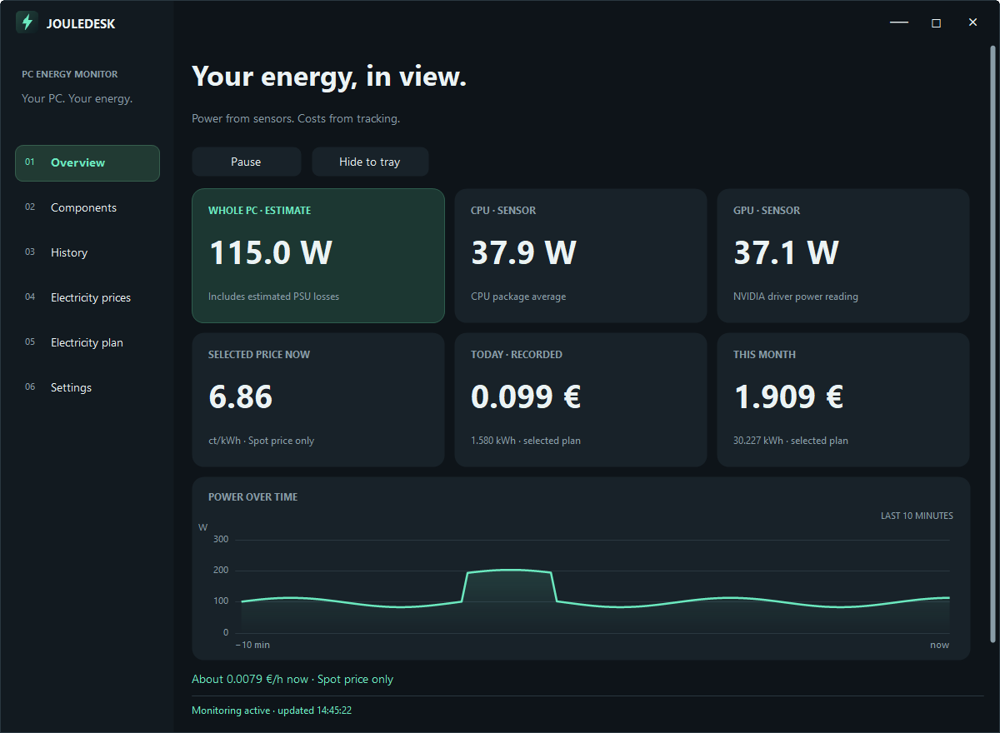
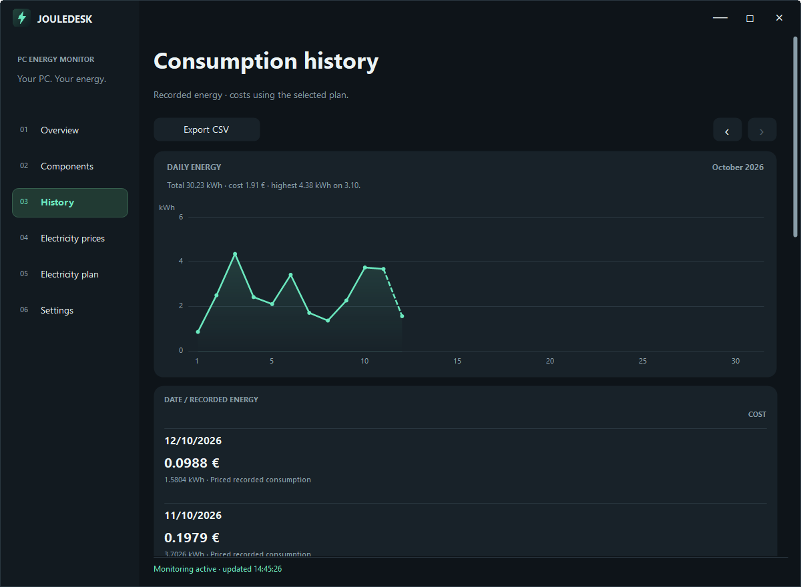
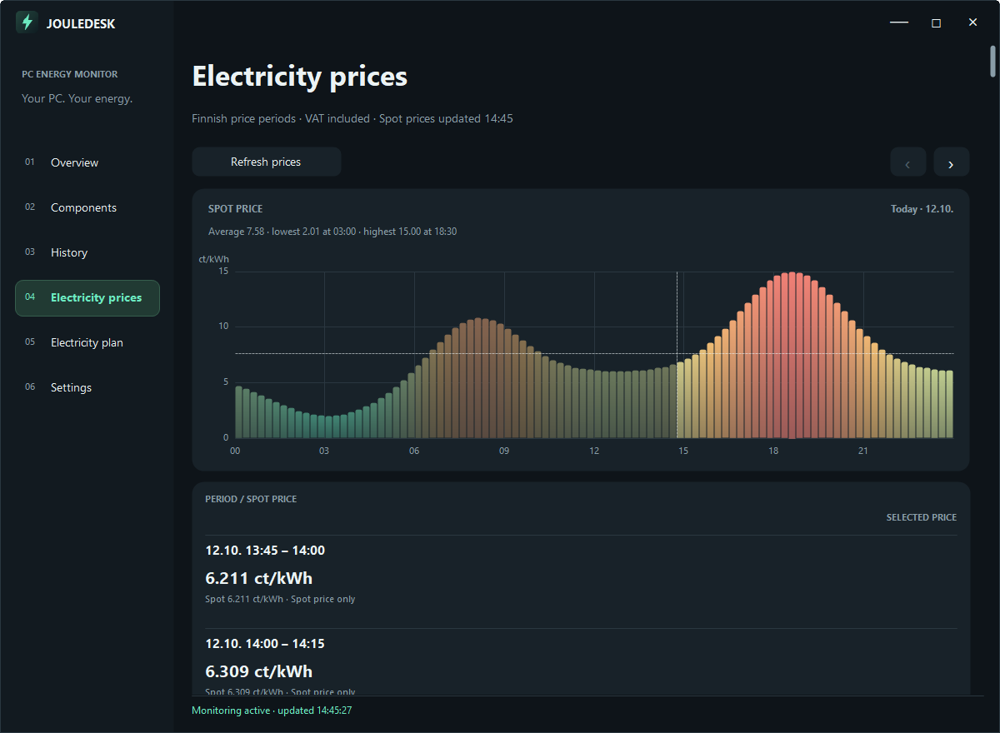
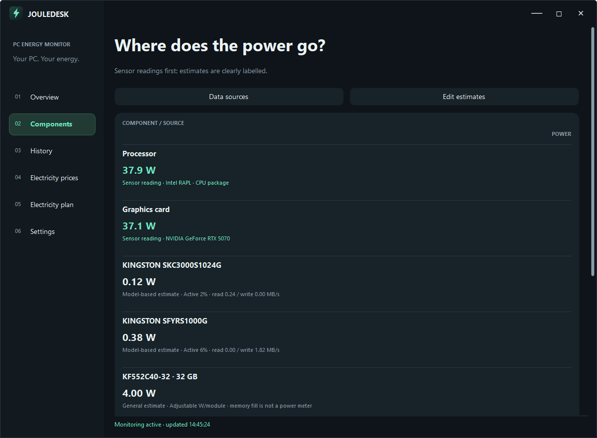
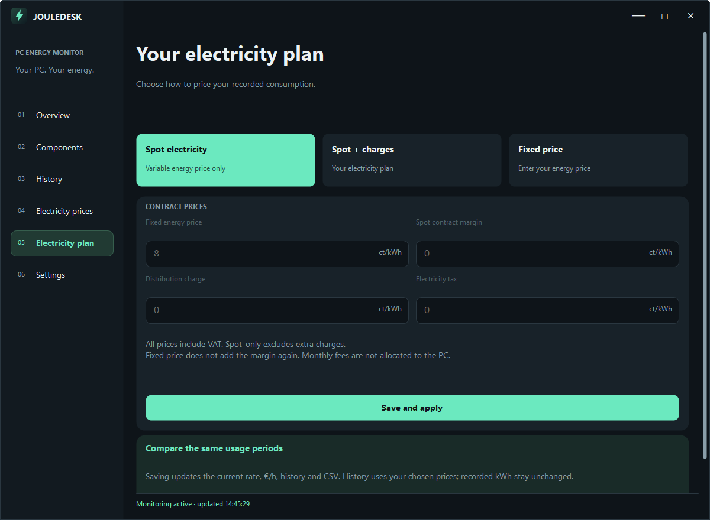
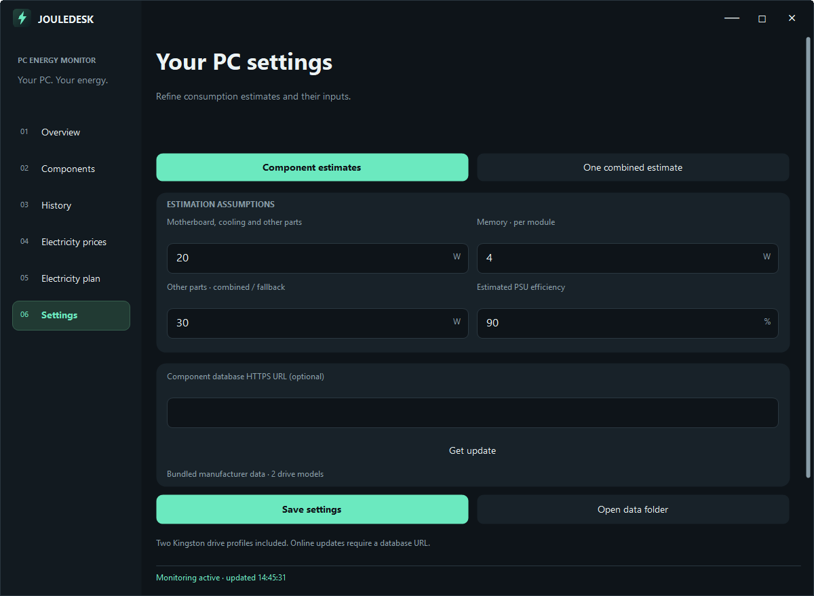

# JouleDesk

[](https://github.com/paulakarhi/JouleDesk/releases/latest)
[](LICENSE)

**[Download the latest installer](https://github.com/paulakarhi/JouleDesk/releases/latest)** for Windows 10 and 11 (x64).

A small, free Windows app that shows what your PC's electricity use costs. It shows how much power the computer
draws, live, per day and per month, and prices the energy with Finnish spot electricity prices or with your own
contract: spot price only, spot price plus your charges, or a fixed price.

It needs **no smart plug, power meter or other add-on**. The processor's power comes from the energy counter Windows
already keeps for it and the NVIDIA graphics card's power from its driver. The rest of the machine is estimated, and
every estimate is labelled as such: a drive's power follows its activity and its model's profile (bundled
manufacturer data, or a catalog you point the app to), and memory, the motherboard and other parts use assumptions
that you can adjust. The result is an estimate of the PC's draw at the wall, not a wall-socket measurement.

Everything runs on your PC. There is no account, no cloud service and no telemetry.



## Screenshots

The overview shows the live power of the CPU, the GPU and the whole PC, the price of electricity now, what today and
this month have cost so far, and a curve of the last ten minutes.

The history page opens with a curve of the energy used on each day of a month, with the month's total, its cost and
its busiest day. Point at the curve to see a day's energy and cost; the arrows move between months. The days are
listed below the curve, priced with the plan you have chosen. A line that ends today is dashed, because the day is not
over.



The prices page shows one day of spot prices as bars, coloured from the cheapest periods of the day to the dearest,
with the average and the current moment marked. Point at a bar to see its time and price.



The components page shows the power of every part and where each figure comes from: a sensor reading, a model-based
estimate or a general estimate.



The electricity plan and the settings:




## Features

- Live power of the CPU, the GPU and the whole PC, sampled every five seconds, with a ten-minute curve
- Costs per day and per month, and a curve of the energy used on each day of a month with its total, its cost and its
  busiest day
- Spot prices for Finland as a bar chart, one bar per price period (hourly or quarter-hourly), with the average and
  the current moment marked and a bubble with the time and price of the bar you point at. The arrows move between the
  days that have prices.
- Three pricing plans: spot price only, spot price plus your contract charges (margin, distribution and electricity
  tax), or a fixed price plus distribution and tax. Changing the plan prices the recorded energy again, so you can
  compare plans; the recorded kWh never change.
- A missing price stays unknown instead of counting as free electricity. The energy is priced later, when the price
  arrives, and a total that leaves out such energy is marked with an asterisk.
- Negative prices are supported
- Every figure is labelled as a sensor reading, a model-based estimate or a general estimate, and the Components page
  lists the source of each
- CSV export of the whole history, with English headings, decimal points and UTC times whatever the language
- Runs in the background from the notification area. Closing the window only hides it, a second launch brings the
  window back, and the app can start when you sign in.
- A window that supports Windows Snap and rearranges itself to fit its width
- Twelve languages: English, Suomi, Svenska, Deutsch, Français, Español, Português, Italiano, Русский, 中文（简体）,
  日本語 and 한국어. The language is chosen in the installer, not in the settings.

## Requirements

- Windows 10 or 11, 64-bit
- A processor whose package energy counter Windows exposes (`RAPL_Package0_PKG` in the Windows energy meter), which
  Intel processors do
- An NVIDIA graphics card with a driver that provides `nvidia-smi`

Without a reading from both the processor and the graphics card nothing is recorded; see Limitations.

## Installing

Download `JouleDesk-Setup-<version>.exe` from the [latest release](https://github.com/paulakarhi/JouleDesk/releases/latest)
and run it, or build the installer from source (below). The first page asks for the language. No separate .NET
installation is needed. The installer

- installs for the current user only, in `%LOCALAPPDATA%\Programs\JouleDesk`, so no administrator rights are needed,
  and adds a Start menu entry. A desktop shortcut and starting when you sign in are optional.
- stores the chosen language in `HKCU\Software\JouleDesk`, value `Language` (for example `fi`),
- adds the sign-in entry to `HKCU\Software\Microsoft\Windows\CurrentVersion\Run` if you choose it.

The installer is not code-signed, so Windows SmartScreen may warn about it. The release page lists the SHA-256
checksum of the installer.

To update, quit JouleDesk with **Settings → Quit app and monitoring** and run the new installer. Your data is kept.
Uninstalling removes the program, its shortcuts and registry entries; the data folder `%LOCALAPPDATA%\JouleDesk` stays
until you delete it.

The program reads the language from the registry at start. Without the value (for example a bare `.exe`) it follows
the Windows display language, and falls back to English.

See the [user guide](docs/UserGuide.md) for the details of pricing, storage and troubleshooting.

## Building

Requires Windows x64 and the .NET 9 SDK.

```powershell
dotnet build JouleDesk.csproj -c Release
dotnet publish JouleDesk.csproj -c Release -r win-x64 -o publish   # publish\JouleDesk.exe, one self-contained file
```

The installer needs [Inno Setup 7](https://jrsoftware.org/isinfo.php). Compile `installer.iss` with `ISCC.exe` after
publishing; the installer takes its version from the published executable and writes
`installer-output\JouleDesk-Setup-<version>.exe`.

### Command-line options

| Option | Effect |
| --- | --- |
| `--background` | start hidden in the notification area; the sign-in entry passes it |

## Project layout

```
Domain/        Settings, prices, usage records, sensor readings, component profiles, accepted ranges
Services/      Energy and tariff calculation, price lookup and fetch schedule, the monitor that turns
               samples into records, the drive profile catalog
Hardware/      Windows counters, GPU telemetry, component estimates
Persistence/   Settings, price cache and history files, CSV export
Platform/      Start with Windows, single-instance signalling, app icon, shell launching
Resources/     Translations (locales.tsv, the English text is the key) and embedded resources
UI/            The window, its pages and its controls. Pages paint their own content and add their own
               controls; the window only hosts them.
installer.iss  Inno Setup script
```

Spot prices are validated and kept in order without overlaps, so lookups use binary search. Daily totals are indexed
when records are added instead of being summed while painting, and neighbouring readings are joined into records of
at most a quarter hour, which keeps the history small. The same pricing rules drive the live display, the daily totals
and the CSV export.

## Limitations

- **Intel and NVIDIA.** The processor's power is read from the Windows energy meter counter of the processor package,
  which Intel processors provide, and the graphics card's power from `nvidia-smi`. Nothing else is looked for. AMD
  processors and other graphics cards have not been tried, and a machine where either reading is missing records
  nothing.
- **An estimate, not a measurement.** The draw at the wall is `(CPU + GPU + other parts) / PSU efficiency`, with a
  default efficiency of 90 %. The rated power of the power supply is its capacity, not what the computer draws.
  Displays and other external devices are not included. A plug-in energy meter is the only way to measure the real
  consumption.
- **Drives.** A drive's power blends its idle and busy figures by how busy Windows reports it to be. This is a
  heuristic, not a measurement. The bundled profiles cover two Kingston models, and other drives use a general
  assumption unless you add a catalog.
- **Memory, motherboard, cooling and other parts** use fixed assumptions (by default 4 W per memory module and 20 W
  for the rest), which you can change in the settings.
- **Finland only.** The spot prices are those of the Finnish market, in euros and Finnish time with VAT included,
  whatever the language of the interface.
- **Gaps.** Nothing is recorded, or made up, while the app is not running, the PC is asleep, monitoring is paused or
  a sensor cannot be read. A pause between two samples of more than twenty seconds is left unrecorded.
- **The price service.** The prices come from a free service run by one person. If it cannot be reached the cached
  prices are used, and energy without a price stays unpriced until the price arrives. The next day's prices usually
  appear in the afternoon.
- **Costs.** Monthly fixed fees are not divided among your devices. The costs are for following your own use, not a
  basis for billing.
- **Windows 10 and 11, 64-bit only.** The installer is not code-signed.
- The translations have not been reviewed by native speakers.

## Privacy

JouleDesk does not collect or send any data about you or your computer. It has no account, no analytics and no crash
reporting. It makes two kinds of network connection, both over HTTPS:

- It fetches the spot prices from [Pörssisähkö.net](https://porssisahko.net/api) when it starts, about twice a day
  after that, a few more times in the afternoon until the next day's prices have been published, and when you press
  **Refresh prices**. The request carries no data of yours. Like any web request it shows your IP address, and the
  name and version of the app, to the service.
- If you enter an address in the settings, it fetches a drive profile catalog from it when the app starts and when you
  press **Get update**. The address and its server are yours to choose.

The hardware that is read (drive models, memory part numbers, the processor's energy counter and the graphics card's
power) is only used on your PC.

What stays on the computer, in `%LOCALAPPDATA%\JouleDesk`:

| File | Contents |
| --- | --- |
| `usage.jsonl` | The recorded energy and its cost, in intervals of at most a quarter hour |
| `settings.json` | Your plan, estimation assumptions and the optional catalog address |
| `prices.json` | The spot prices fetched most recently |
| `components.json` | The drive profile catalog downloaded from your address, if you set one |
| `component-sources.txt`, `usage-*.csv` | Written only when you ask for the data sources or an export |

The language chosen in the installer and the sign-in entry are stored in your user registry hive. To remove your
records, delete the data folder. To back them up, quit the app and copy it.

## License

JouleDesk is released under the [MIT License](LICENSE). The components it builds on keep their own licenses, and the
installer includes their notices; see [THIRD-PARTY-NOTICES.md](THIRD-PARTY-NOTICES.md). The electricity prices come from
the free [Pörssisähkö.net](https://porssisahko.net/) service, which publishes the Nord Pool day-ahead prices for
Finland, and the bundled drive profiles use the figures in Kingston's published specifications. Intel, NVIDIA,
Kingston and Windows are trademarks of their owners; they are named only to say what JouleDesk works with, and
JouleDesk is not affiliated with or endorsed by any of them.
